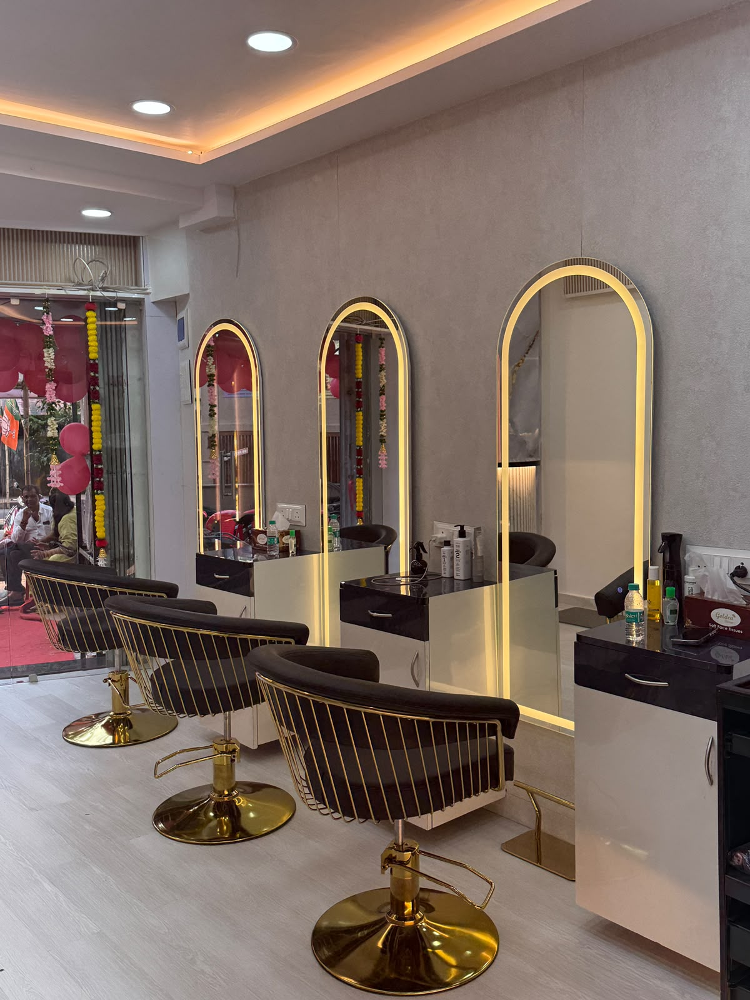

# Elara Atelier — Luxury Unisex Salon & Spa

A modern, responsive multi-page website for **Elara Atelier (Elara Unisex Salon)** located at Touchwood Building, Sahaj Raje Road, Vile Parle East, Mumbai.



---

## 🌟 Key Features

* **Multi-Page Architecture**:
  * **Home (`index.html`)**: Hero section, 8 signature circular services, auto-playing luxury video reels, salon ambiance showcase, client reviews, location map, and direct contacts.
  * **Services (`services.html`)**: Complete pricing and treatment catalog with interactive category filters (*Hair Cut & Styling*, *Color & Balayage*, *Keratin & Nanoplastia*, *HydraFacial & Skin Care*, *Bridal & Makeup*, *Nail Extensions*, *Men's Grooming*).
  * **Lookbook & Gallery (`gallery.html`)**: Filterable real-client portfolio with interactive lightbox zoom and Before/After transformation comparison.
  * **About Us (`about.html`)**: Brand story, philosophy (*"Look Good. Feel Good. Always."*), master stylist director profiles (**Anand** & **Dildar**), and international brand partnerships (*L'Oréal Professionnel Paris*, *Kérastase*, *Olaplex*, *Dyson Pro*, *MAC*, *O.P.I.*).
  * **Appointment Booking (`booking.html`)**: Interactive booking engine with live price/duration calculator, stylist selector, date & slot picker, receipt popup, and 1-click **WhatsApp reservation dispatch**.
  * **Contact & Location (`contact.html`)**: Interactive Google Maps embed, direct call buttons, directions guide, and appointment inquiry form.

* **Cinema & Smartphone Video Reels**:
  * Dual luxury gold-framed video player with auto-play (`autoplay muted loop playsinline`), sound toggle, play/pause controls, and live status badge.

* **Design System**:
  * **Theme**: Midnight Obsidian (`#0a0b0d`), Champagne Gold (`#d4af37`), and Soft Blush Rose Gold (`#dfb29e`).
  * **Typography**: Luxury serif (*Playfair Display*) paired with clean sans-serif (*Plus Jakarta Sans*).
  * **Mobile-First Responsiveness**: Smooth slide-out mobile drawer, sticky glassmorphism navigation bar, and floating quick-action buttons for WhatsApp & Phone.

---

## 📍 Location & Contacts

* **Address**: Touchwood Building, Shop No. 4, Sahaj Raje Road, Opp. Parle Eshwar Soc, Near Bhuta School, Vile Parle East, Mumbai – 400057
* **Anand (Master Stylist)**: [+91 9820358282](tel:9820358282)
* **Dildar (Senior Stylist)**: [+91 9555234427](tel:9555234427)
* **Salon Reception**: [+91 9867623177](tel:9867623177)
* **Visiting Hours**: Monday – Sunday: 10:00 AM – 9:30 PM (All 7 Days)

---

## 🚀 Getting Started

1. Clone the repository:
   ```bash
   git clone https://github.com/aaryavtechnologies-tech/Elara-Atelier.git
   cd Elara-Atelier
   ```

2. Open `index.html` directly in any web browser, or start a lightweight local HTTP server:
   ```bash
   python -m http.server 8080
   ```
   Then visit `http://localhost:8080`.

---

## 📄 License
© 2024–2026 Elara Atelier / Sahaj Raje Road, Vile Parle East, Mumbai. All Rights Reserved.
